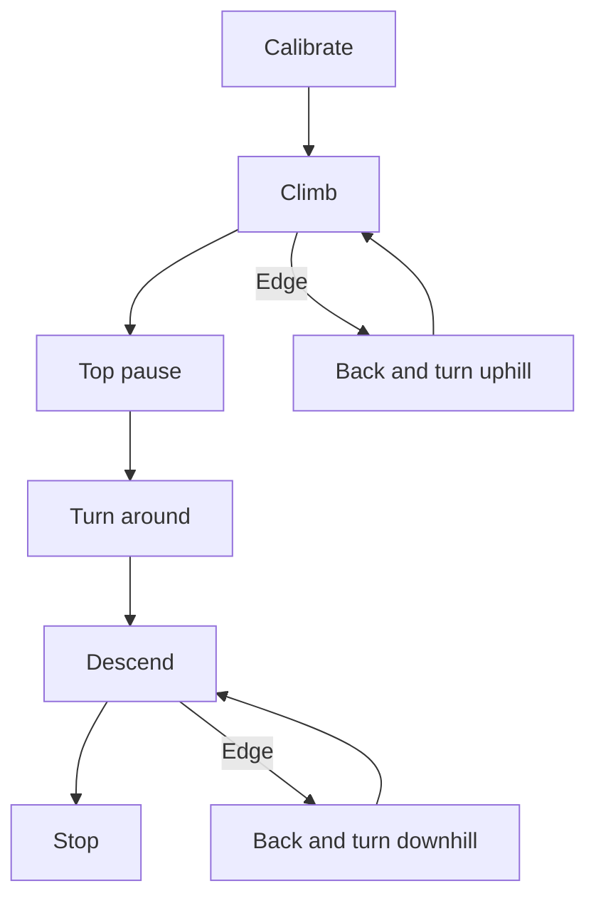

# Pololu Embedded Systems Labs

My embedded-systems lab implementations for the **Pololu 3pi+ 2040 robot**, using **Lingua Franca's C target** on the RP2040.

The repository contains **17 lab programs and two local library reactors**, alongside the original examples and development environment. The work progresses from timers and GPIO to interrupts, sensor feedback, modal motion control, and hill climbing.

## Explore the code

| Area | Implementations |
| --- | --- |
| Timers and reusable components | Two-timer blinking, serial output, and an LED reactor |
| Peripherals | Memory-mapped GPIO and button-state display |
| Interrupts | Callbacks, physical actions, debouncing, and modal counting |
| Sensor processing | Accelerometer-based pitch and roll |
| Robot motion | Drive/stop modes, encoder distance, square driving, and bump recovery |
| Hill climbing | Line calibration, edge recovery, roll correction, turnaround, descent, and stopping |

- [Lab catalog](docs/LABS.md): source links and actual behavior.
- [Build and flash](docs/BUILD.md): setup and commands.
- [Validation](docs/VALIDATION.md): host checks and hardware checklist.
- [Integrated hill-climb controller](src/HillClimbSolution.lf).

These are my lab implementations built on an upstream teaching template and hardware library. Runtime, SDK, starter examples, and simulator credits are retained below.

## Quick start

From an existing checkout:

```bash
git submodule update --init
nix develop
make list
make test
make build APP=ToolsBlinkSolution
```

Host tests need Python 3 and a host C compiler. Firmware builds additionally need LF and the ARM toolchain; the Nix shell does not install `lfc`. See [Build and flash](docs/BUILD.md).

```bash
make build APP=HillClimbSolution
make build-all
```

These commands compile; flashing is a separate step.

## Hill-climbing controller

Sensors are sampled every **50 ms**. The controller calibrates line detection, climbs with feedback-controlled wheel speeds and bounded roll correction, pauses at the top, turns using the gyroscope, descends, and stops after detecting level ground.

Edges trigger a timed backing-and-turning sequence before the robot resumes ascent or descent. See the [tuning notes](docs/LABS.md#hill-climbing).



## Tests and hardware

`make test` compiles the **actual C math extracted from the LF sources**, checking tilt calculations and clamping with 17 numerical assertions. It does not compile LF or validate scheduling, sensor calibration, or motor behavior.

I previously exercised the hill-climb program on my physical robot. A fresh full-project build and recorded hardware demonstration are still to be logged in [Validation](docs/VALIDATION.md). No exact turn accuracy or measured timing guarantee is claimed.

## Layout

| Path | Contents |
| --- | --- |
| `src/*Solution.lf` | Lab implementations |
| `src/lib/` | LED and tilt reactors |
| Other `src/` files and `src/test/` | Retained examples and motor diagnostics |
| `scripts/` | Host-side numerical checks |
| `test/` | Inherited Pico emulator, not a complete Pololu simulation |
| `pico-sdk/`, `lf-packages/pololu-3pi-c/` | Pinned Git submodules |

Build outputs stay ignored. SDK downloads are represented by submodule references rather than copied into this repository.

## Credits and license

Based on [lf-lang/lf-3pi-template](https://github.com/lf-lang/lf-3pi-template) and the [Lingua Franca Embedded Systems Labs](https://www.lf-lang.org/embedded-lab/GettingStarted.html).

Hardware integration uses [pololu-3pi-c](https://github.com/lf-lang/pololu-3pi-c) and the [Pico SDK](https://github.com/raspberrypi/pico-sdk). The inherited emulator uses [Wokwi/rp2040js](https://github.com/wokwi/rp2040js).

Original author notices and [LICENSE.txt](LICENSE.txt) are retained. The template begins with the University of California BSD 2-clause notice; bundled code and submodules retain their own notices. This project does not claim authorship of those dependencies.


